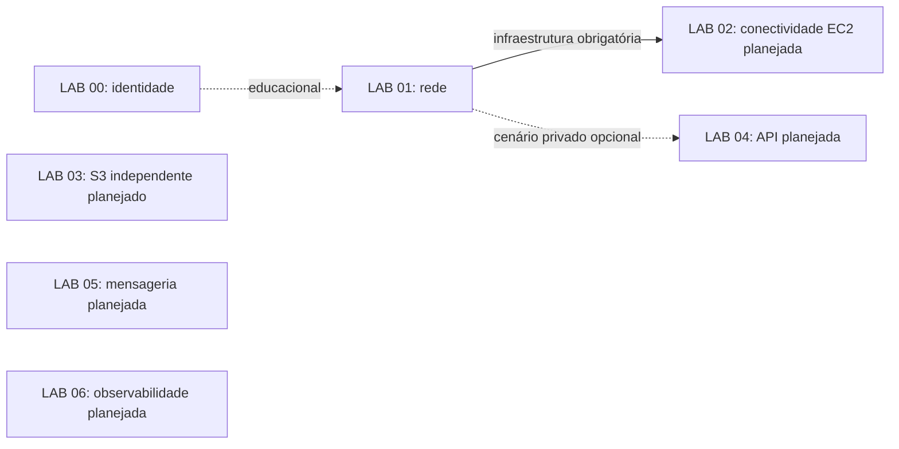

# Dependências, contratos e ciclo de vida

O modelo é um Directed Acyclic Graph (DAG), não um mecanismo de execução. O [schema v1](../../shared/schemas/lab-v1.schema.json) e os manifestos são a fonte de verdade das arestas. IDs não incluem numeração: `vpc-networking` continua estável se o caminho de apresentação mudar mediante revisão. IDs de arestas são estáveis dentro do LAB consumidor.

| Tipo | Significado | Efeito operacional |
| --- | --- | --- |
| `educational` | Conhecimento recomendado de outro LAB | Nunca provisionar infraestrutura automaticamente |
| `operational` | Pré-condição como sessão federada, ferramentas ou acesso autorizado | Conferir execução; não concede permissões nem exige recriar o LAB de origem |
| `infrastructure-required` | Consumidor requer recursos e contrato do produtor | Produtor disponível e compatível antes do consumidor |
| `infrastructure-optional` | Recurso necessário somente no cenário textual indicado | Operador seleciona o cenário; nenhuma expressão ou condição executável |
| `functional-integration` | Interação entre capacidades, sem assumir ownership | Documentar interface, disponibilidade e isolamento antes de ativar |

A numeração não cria arestas. LAB 03 S3 não depende da VPC por padrão; LAB 04 só a consome no cenário opcional privado. As declarações de publicação e certificação também não criam dependências.

O validador percorre todas as arestas, inclusive opcionais, detecta ciclos e mostra uma ordenação conceitual. Ela **não** é um plano de provisionamento: filtrar tipos, selecionar cenários e verificar recursos ativos serão responsabilidades de um futuro planejador. Dependências transitivas são o fechamento das arestas selecionadas: LAB 02 requer a rede do LAB 01 e herda sua recomendação educacional de identidade, sem exigir que LAB 00 seja recriado.

## Contrato network-foundation v1

O produtor `vpc-networking` possui o estado e os 12 recursos do LAB 01. O primeiro consumidor planejado é `ec2-connectivity`. Os outputs existentes são preservados; os nomes de inputs abaixo são **proposta de interface**, não variáveis implementadas no LAB 02.

| Output LAB 01 | Input proposto LAB 02 | Tipo | Uso |
| --- | --- | --- | --- |
| `vpc_id` | `network_vpc_id` | string | VPC autorizada para recursos do consumidor |
| `public_subnet_ids` | `network_public_subnet_ids` | list(string), duas entradas | Mesma ordem de AZs do produtor |
| `private_subnet_ids` | `network_private_subnet_ids` | list(string), duas entradas | Mesma ordem de AZs do produtor |
| `internet_gateway_id` | `network_internet_gateway_id` | string | Inspeção, sem gerenciar o gateway |
| `public_route_table_id` | `network_public_route_table_id` | string | Inspeção, sem alterar rotas ou associações |
| `private_route_table_id` | `network_private_route_table_id` | string | Inspeção, sem alterar a tabela |

A transferência inicial será manual, por allowlist desses outputs para arquivo local ignorado e protegido. Não copiar state inteiro, publicar IDs ou persistir saídas em logs públicos. A documentação de conta/região acompanha a entrega local: conferir identidade temporária, conta autorizada, `sa-east-1`, tags, VPC, subnets, AZs e versão do contrato antes de consumir. Nomes de AZs podem variar fisicamente entre contas; não reutilizar IDs entre contas/regiões. O manifesto registra versão de contrato, não compatibilidade automática de providers. Mudanças incompatíveis exigem nova versão e revisão de todos os consumidores; a v1 não aceita outra versão.

## Ownership e isolamento

Um recurso tem exatamente um proprietário e um Terraform State. O consumidor referencia IDs; não importa, redefine ou passa a gerenciar recursos do produtor. O catálogo deriva o LAB proprietário da capacidade a partir de `provides`; não repete esse dado em outro arquivo. Uma capacidade planejada não pode ser tratada como infraestrutura disponível.

Cada execução futura deve ter `environment_id` e `run_id` únicos, conta/região autorizadas, responsável humano, diretório de estado isolado e limite de retenção. Antes de permitir execuções simultâneas, revisar nomes físicos, chaves de backend e inputs para evitar colisões. O LAB 01 atual usa estado local no seu diretório: não oferece isolamento automático para múltiplos usuários. Até evoluir isso, apenas um operador e uma execução por diretório/ambiente, com exclusão mútua operacional; nunca compartilhar esse diretório ou executar dois processos Terraform. O lock local não equivale a coordenação distribuída.

## Registro de ambientes e cleanup

[Modelo local de registro](../../shared/templates/environment-record.example.json): template, não registro real. Armazenar cópia preenchida somente em `local/`, já ignorado. Deve registrar IDs sanitizados na publicação, stacks ativos, paths/keys privados de estado, consumidores, conta/região autorizadas, responsável, aprovação, prazo, custo estimado e condição de encerramento. Estado de execução é separado do status de implementação no manifesto. Git é fonte de verdade do desenho, não inventário em tempo real da AWS.

1. Revisar DAG, contratos, orçamento, conta e região com o operador autorizado.
2. Provisionar produtores de infraestrutura necessários antes dos consumidores, somente após aprovação explícita; dependências educacionais não entram nessa ordem.
3. Registrar cada stack e suas referências; em falha intermediária, interromper, preservar state e evidências privadas e reconciliar recursos reais antes de tentar novamente. Não fazer rollback automático de dependências compartilhadas.
4. Cleanup segue ordem inversa **das dependências de infraestrutura ativadas**. Bloquear remoção do produtor enquanto houver qualquer consumidor ativo, inclusive de outra execução. Verificação manual é obrigatória nesta fase; o validador estático não conhece consumidores ativos.
5. Revisar plano de remoção, ownership e alvos; obter aprovação; remover consumidores e depois a fundação se não houver uso compartilhado. Confirmar recursos remanescentes e custos, não apenas estado vazio. Registrar fechamento ou extensão aprovada da retenção.

A fundação é reutilizável por reprovisionamento; não precisa permanecer ativa. Recursos compartilhados de identidade do LAB 00 não são eliminados no cleanup de workloads. Nenhuma automação deste PR executa essas etapas na AWS.
