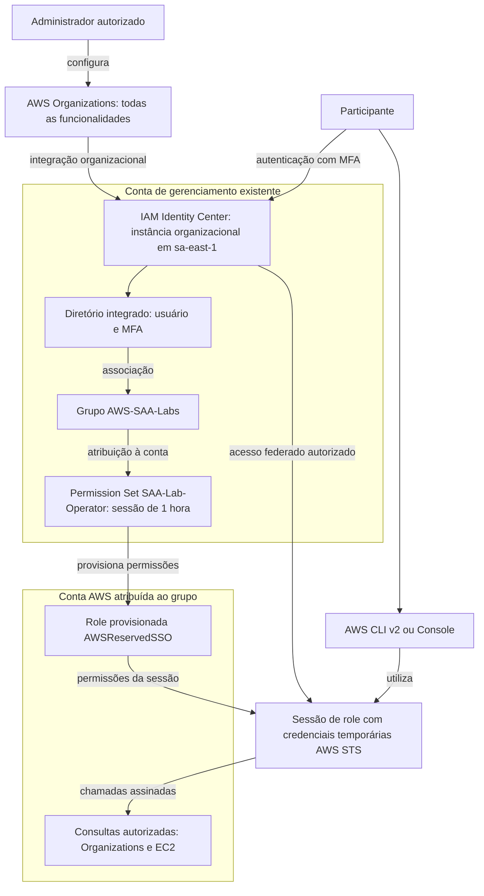
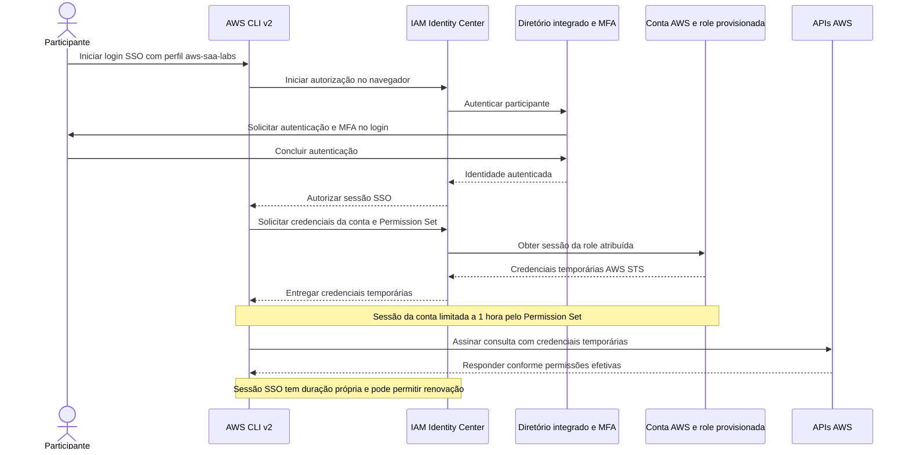

# Diagramas — identidade e acesso

Os diagramas descrevem o LAB 00 sem IDs de conta, ARNs reais, nomes pessoais ou URLs privadas. Não representam contas membro, OUs ou SCPs adicionais como implantados.

## Componentes

A conta atribuída é uma representação lógica do destino do acesso; não indica uma segunda conta criada. O histórico não detalha um inventário de contas membro. Administração da organização e uso da role operacional são responsabilidades distintas.

## Fluxo de autenticação e uso da CLI

O fluxo é conceitual: não descreve todas as chamadas internas do serviço. A CLI obtém as credenciais pelo IAM Identity Center; o usuário não precisa chamar `sts assume-role` manualmente nem armazenar chaves permanentes. Sessões SSO existentes podem ser reutilizadas; MFA é exigido no login, não em cada chamada API.

Veja [arquitetura](../docs/architecture.md), [implementação](../docs/implementation.md) e [validação](../docs/validation.md).
