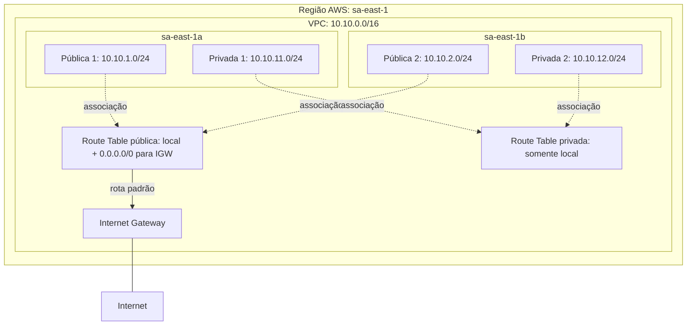

# LAB 01 — Fundamentos de Amazon VPC e redes

[Início do repositório](../../README.md) · [Como contribuir](../../CONTRIBUTING.md) · [Revisão de engenharia](../../docs/lab01-engineering-review.md)

## 1. Visão geral

Construa uma rede IPv4 em duas Availability Zones na região `sa-east-1` usando Terraform. Este laboratório apresenta a classificação de subnets, associações explícitas de Route Tables, configurações DNS, proteção contra uso da conta incorreta e validação da infraestrutura.

O responsável pelo repositório confirmou que a infraestrutura original foi provisionada, inspecionada por meio da AWS CLI e do Terraform State e destruída com sucesso. Não foram realizados testes de conectividade entre workloads. Esta revisão de engenharia não provisiona infraestrutura nem repete a validação histórica na AWS.

## 2. Cenário de negócio

Uma equipe precisa de uma fundação de rede para futuros pontos de entrada públicos e componentes privados de aplicação. Antes de implantar workloads, é necessário tornar as decisões de endereçamento, roteamento, responsabilidade e ciclo de vida explícitas e reproduzíveis.

Esta é uma fundação de rede, não uma aplicação de produção ou um sistema completo de alta disponibilidade. Duas AZs oferecem opções de distribuição; não foram testados processamento, failover ou disponibilidade de aplicações.

## 3. Arquitetura

| Componente gerenciado pelo Terraform | Quantidade |
| --- | ---: |
| VPC | 1 |
| Subnets públicas | 2 |
| Subnets privadas | 2 |
| Internet Gateway | 1 |
| Route Tables personalizadas | 2 |
| Associações explícitas de subnets a Route Tables | 4 |
| **Total de recursos gerenciados** | **12** |

A rota padrão pública é um bloco inline da respectiva Route Table, não um recurso Terraform adicional. A AWS também cria objetos padrão da VPC, incluindo uma Route Table principal, um security group e uma network ACL; eles não são gerenciados separadamente por esta configuração nem entram na contagem acima.

Cada camada de subnets possui uma subnet em cada AZ. O suporte a DNS e os nomes de host DNS da VPC estão habilitados. As subnets públicas habilitam a atribuição automática de IPv4 público para futuros lançamentos; as privadas a desabilitam. Não há EC2, NAT Gateway, Elastic IP, Load Balancer ou VPC endpoint nesta arquitetura.

## 4. Diagrama de arquitetura



As linhas tracejadas representam associações de configuração. O diagrama não representa tráfego observado ou conectividade testada. A Route Table privada não possui rota padrão para a internet.

## 5. Endereçamento de rede

| Escopo | CIDR IPv4 | AZ | IPv4 público no lançamento |
| --- | --- | --- | --- |
| VPC | `10.10.0.0/16` | Regional | Não se aplica |
| Pública 1 | `10.10.1.0/24` | `sa-east-1a` | Habilitado |
| Pública 2 | `10.10.2.0/24` | `sa-east-1b` | Habilitado |
| Privada 1 | `10.10.11.0/24` | `sa-east-1a` | Desabilitado |
| Privada 2 | `10.10.12.0/24` | `sa-east-1b` | Desabilitado |

Mantenha esses valores padrão para reproduzir a arquitetura validada. Os nomes das AZs podem corresponder a zonas físicas diferentes entre contas AWS; confirme sua disponibilidade na conta antes do provisionamento. A validação de variáveis verifica sintaxe, correspondência entre listas de duas entradas e unicidade dentro de cada lista. Ela não comprova que os CIDRs estão contidos na VPC, que não há sobreposição entre camadas ou que as AZs estão disponíveis na AWS; revise esses pontos antes de alterar parâmetros.

## 6. Configuração de roteamento

| Route Table personalizada | Destino | Alvo | Subnets associadas |
| --- | --- | --- | --- |
| Pública | `10.10.0.0/16` | `local` (rota criada pela AWS) | Públicas 1 e 2 |
| Pública | `0.0.0.0/0` | Internet Gateway | Públicas 1 e 2 |
| Privada | `10.10.0.0/16` | `local` (rota criada pela AWS) | Privadas 1 e 2 |

A camada privada não possui roteamento direto para a internet. A rota de uma subnet pública, isoladamente, não estabelece conectividade com workloads: uma futura instância também precisará de endereço público e regras adequadas de security group e network ACL. A rota local fornece roteamento dentro da VPC, não uma garantia de autorização. Consulte a [documentação AWS sobre Route Tables](https://docs.aws.amazon.com/vpc/latest/userguide/VPC_Route_Tables.html).

## 7. Decisões de arquitetura

- Manter um único diretório raiz Terraform e referências diretas aos recursos. Doze recursos não justificam uma hierarquia de módulos ou módulos externos.
- Preservar `count` e as listas ordenadas de subnets para manter os endereços existentes dos recursos. Reordenar AZs ou CIDRs pode substituir subnets indexadas e suas associações. Uma futura mudança para `for_each` exige blocos `moved` revisados ou migração de estado.
- Manter as tags originais Name e Tier, além das tags padrão do provider: `Project=aws-saa-labs`, `Lab=lab01`, `Environment=lab`, `ManagedBy=Terraform`.
- Manter duas Route Tables personalizadas compartilhadas: uma por política de roteamento. Uma tabela privada por AZ não oferece benefício enquanto cada tabela contiver somente a rota local.
- Omitir NAT e workloads para concentrar escopo e custos na configuração de rede.
- Exigir `aws_account_id` localmente e aplicar `allowed_account_ids`. Isso substitui a constante da conta original sem enfraquecer a proteção. Usuários existentes precisam informar o ID da conta antes de gerar um plano; trata-se de mudança de parâmetro, não de endereço de recurso.
- Manter Terraform State local neste laboratório individual. Um backend compartilhado e criptografado exige projeto e autorização separados; nenhum é criado aqui.

## 8. Tecnologias

O CI utiliza Terraform CLI `1.15.8` como referência; a configuração aceita `>= 1.15.0, < 2.0.0`. A restrição do provider AWS é `~> 6.0`, resolvida para `6.74.0` no lock file versionado. O GitHub Actions executa em `ubuntu-24.04`; Python 3 descobre os diretórios raiz usando somente a biblioteca padrão. A AWS CLI v2 apoia a validação por operadores humanos; o Mermaid documenta a arquitetura.

## 9. Estrutura do repositório

```text
labs/lab01-vpc-networking/
├── README.md
└── terraform/
    ├── .gitignore
    ├── .terraform.lock.hcl
    ├── main.tf
    ├── outputs.tf
    ├── providers.tf
    ├── terraform.tfvars.example
    ├── variables.tf
    └── versions.tf
```

O [workflow de CI](../../.github/workflows/terraform-ci.yml) e o [script de descoberta](../../shared/scripts/discover-terraform.py) são compartilhados. Políticas ou evidências locais fora dessa estrutura versionada não são entregáveis validados.

## 10. Pré-requisitos

- Conta AWS própria, preferencialmente uma conta-membro dedicada a testes, e autorização para criar e remover os recursos de rede listados.
- Terraform `1.15.8`, AWS CLI v2, Git e acesso de rede ao registry de providers e aos downloads da HashiCorp.
- Credenciais federadas temporárias, preferencialmente IAM Identity Center com MFA. Escolha seu próprio perfil da AWS CLI; não use chaves de acesso estáticas.
- Permission Set revisado separadamente, cobrindo o ciclo de vida do Terraform e as operações de leitura. A política do operador de leitura do [LAB 00](../lab00-identity-governance/README.md) é insuficiente. Esta revisão não publica nem certifica uma política IAM completa para o LAB 01.
- Revisão da conta, região, custos, dependências e armazenamento do estado local antes da execução.

O LAB 00 é a referência de identidade e governança; este diretório raiz Terraform não consome seu estado nem cria ou altera suas configurações de IAM ou Organizations. Uma federação equivalente já existente pode ser utilizada em outra conta. O LAB 01 é responsável pelos 12 recursos de rede; nenhum recurso de rede provisionado é herdado.

## 11. Instruções de provisionamento

Os comandos abaixo são procedimentos para um operador humano autorizado. Eles não foram executados na AWS durante esta revisão de engenharia. O `apply` exige autorização explícita separada; o CI nunca o executa.

A partir da raiz do repositório:

```bash
cd labs/lab01-vpc-networking/terraform
umask 077
cp terraform.tfvars.example terraform.tfvars
```

Edite o arquivo ignorado `terraform.tfvars`: substitua o valor de exemplo composto por zeros pelo ID de 12 dígitos da sua conta autorizada e configure `aws_profile` com seu perfil autenticado. Mantenha todos os valores padrão de rede. O valor de exemplo, intencionalmente, não autoriza nenhuma conta real. Para usar a cadeia padrão de credenciais temporárias, defina `aws_profile = null`.

No procedimento com perfil, use o mesmo perfil nas verificações da CLI e no Terraform:

```bash
export AWS_PROFILE=your-sso-profile
export AWS_REGION=sa-east-1
aws sso login --profile "$AWS_PROFILE"
aws sts get-caller-identity --query Account --output text
terraform fmt -check -recursive
terraform init -backend=false -input=false -lockfile=readonly
terraform validate
terraform plan -out=lab01.tfplan
```

Confira se a conta retornada pelo STS corresponde ao ID autorizado informado localmente e se `aws_profile` corresponde a `AWS_PROFILE`. Inspecione o plano: com estado novo, devem ser propostas **12 adições**, com o endereçamento e as rotas descritos acima. Interrompa se os alvos ou as alterações forem diferentes. Um estado existente pode não gerar mudanças. Nunca publique o plano, o Terraform State ou saídas brutas da CLI.

Somente após aprovação explícita desse plano salvo:

```bash
terraform apply lab01.tfplan
```

Mantenha o estado protegido até concluir o cleanup. Nunca descarte o estado para recomeçar; investigue primeiro qualquer recurso existente inesperado.

## 12. Validação da infraestrutura

Após um provisionamento autorizado, execute no diretório Terraform com as mesmas credenciais temporárias, conta e região:

```bash
terraform state list
terraform output
VPC_ID=$(terraform output -raw vpc_id)
aws ec2 describe-vpcs --vpc-ids "$VPC_ID" --region "$AWS_REGION"
aws ec2 describe-vpc-attribute --vpc-id "$VPC_ID" --attribute enableDnsSupport --region "$AWS_REGION"
aws ec2 describe-vpc-attribute --vpc-id "$VPC_ID" --attribute enableDnsHostnames --region "$AWS_REGION"
aws ec2 describe-subnets --filters "Name=vpc-id,Values=$VPC_ID" --region "$AWS_REGION"
aws ec2 describe-internet-gateways --filters "Name=attachment.vpc-id,Values=$VPC_ID" --region "$AWS_REGION"
aws ec2 describe-route-tables --route-table-ids "$(terraform output -raw public_route_table_id)" "$(terraform output -raw private_route_table_id)" --region "$AWS_REGION"
```

Evidências esperadas: 12 entradas gerenciadas no Terraform State; quatro subnets com os CIDRs, AZs e configurações de IP público exatos; ambos os atributos DNS habilitados; um IGW anexado; uma rota padrão pública para o IGW; uma tabela privada somente com a rota local; quatro associações explícitas de subnets; e tags consistentes. Inspecione as listas de associações das duas Route Tables. Os outputs apresentam os IDs da VPC, subnets, gateway e Route Tables personalizadas para inspeção local.

Essas verificações inspecionam a configuração e o gerenciamento pelo Terraform. Elas não testam tráfego, failover, throughput, segurança dos workloads ou permissões IAM efetivas. Não adicione workloads apenas para alegar validação de conectividade neste laboratório.

## 13. Workflow de CI/CD

Este repositório implementa somente CI. A matriz descobre diretórios raiz versionados no padrão `labs/labNN-topic/terraform/`, com arquivos `.tf` diretamente no diretório; cada diretório raiz deve versionar `versions.tf` e `.terraform.lock.hcl`. A ausência de arquivos obrigatórios faz a descoberta falhar; uma matriz vazia é registrada e sua validação é ignorada. Caches de providers e diretórios não versionados não entram na matriz.

Pushes para `main`, `feat/**`, `fix/**`, `chore/**`, Pull Requests destinados à `main` e acionamentos manuais iniciam as verificações quando os caminhos aplicáveis mudam. Cada diretório raiz executa `fmt -check -recursive`, `init` sem backend e com lock file somente leitura e `validate` de forma independente. Falhas de validação não cancelam os outros diretórios da matriz. Quatro jobs podem validar simultaneamente; a descoberta rejeita mais de 256 entradas, limite da matriz do GitHub.

O workflow usa permissões de leitura do repositório, actions fixadas por SHA com runtimes Node.js 24, nenhuma persistência de credenciais do checkout, limites de tempo por job e cancelamento de execuções anteriores na mesma referência. Terraform e o lock do provider permanecem nas versões validadas. Imagens dos runners e downloads de rede continuam evoluindo; fixar SHAs não torna todo o ambiente imutável. Não há credenciais AWS, OIDC, acesso a backend remoto, planos, provisionamentos ou jobs de cleanup. Consulte o [relatório de revisão](../../docs/lab01-engineering-review.md) para as evidências de execução reais.

## 14. Segurança e governança

A lista de contas autorizadas reduz o risco de provisionamento na conta errada; ela não concede permissões nem substitui a revisão IAM. A seleção de perfil é portável e utiliza credenciais temporárias. Não amplie a política do LAB 00 nem modifique IAM ou Organizations como parte deste laboratório.

O Terraform State local e os planos salvos podem conter valores sensíveis e identificadores de recursos. Eles são ignorados pelo Git, mas também precisam de acesso restrito em disco, proteção contra compartilhamento em logs e backups e inspeção antes da inclusão na área de preparação. Versione somente o lock file do provider e exemplos sanitizados. Não publique ARNs de sessões ou IDs reais de contas e recursos como evidência.

A configuração preserva o comportamento dos security groups e network ACLs padrão criados pela AWS. Ela não constitui endurecimento de segurança da rede para futuros workloads. Antes de expandi-la, revise separadamente controles específicos dos workloads, registros de eventos e colaboração sobre o estado.

## 15. Considerações de custos

A configuração não inclui processamento, NAT Gateway, endereços IPv4 públicos alocados, balanceadores de carga ou endpoints. Habilitar a atribuição de IP público na subnet não aloca um endereço por si só. Os componentes básicos da VPC listados não introduzem cobranças horárias de serviço no modelo atual; uso futuro de IPv4 público, transferência de dados e serviços adicionais podem gerar cobranças. Consulte novamente os [preços oficiais da VPC](https://aws.amazon.com/vpc/pricing/) antes do provisionamento.

Esse escopo não comprova ausência de cobranças em toda a conta. Utilize a visibilidade de faturamento existente e revise dependências antes do cleanup. Nenhum recurso pago de monitoramento ou faturamento é introduzido aqui.

## 16. Conceitos fundamentais do SAA-C03

- Projetar fundações de rede seguras: limites da VPC, camadas de subnets e separação entre roteamento e controles de segurança.
- Projetar arquiteturas resilientes: VPC regional e subnets vinculadas a AZs; duas AZs, isoladamente, não garantem disponibilidade de aplicações.
- Projetar redes adequadas: rotas locais, seleção pelo prefixo mais específico, associações explícitas e requisitos de IGW para tráfego IPv4 público.
- Projetar arquiteturas com custos otimizados: compreender quando NAT, IPv4 público e endpoints são necessários antes de adicionar seus custos.
- Aplicar governança e repetibilidade: credenciais temporárias, proteção da conta, tags, versões fixadas e mudanças de IaC revisadas.

## 17. Instruções de cleanup

A infraestrutura original já foi destruída. Não execute cleanup em outra conta ou sobre recursos alheios ao laboratório. Após qualquer provisionamento futuro, o operador responsável pelo Terraform State responde pela remoção ou retenção documentada dos recursos.

Antes do cleanup, confirme a conta, região, estado exato e consumidores dependentes. Nenhum LAB posterior está documentado como consumidor atualmente. Se LABs futuros reutilizarem esta rede, registre-os e remova suas dependências primeiro; não destrua fundações compartilhadas ainda em uso. Reutilização é uma opção, não evidência de que recursos existem atualmente.

Para um cleanup explicitamente autorizado, usando o mesmo diretório raiz e estado:

```bash
aws sts get-caller-identity --query Account --output text
terraform plan -destroy -out=lab01-cleanup.tfplan
```

Revise o plano de destruição e obtenha aprovação de seus alvos e dependências antes de executar:

```bash
terraform apply lab01-cleanup.tfplan
terraform state list
aws ec2 describe-vpcs --filters Name=tag:Project,Values=aws-saa-labs Name=tag:Lab,Values=lab01 --region "$AWS_REGION"
```

Um estado vazio e a ausência da VPC alvo apoiam a verificação do cleanup deste laboratório, não a ausência de cobranças em toda a conta. Remova planos locais ignorados após o uso, conforme seus requisitos de retenção; preserve evidências de recuperação protegidas quando necessário. Nunca exclua o Terraform State antes de remover os recursos. Não remova as fundações de identidade e governança do LAB 00.

## 18. Resultados

O responsável confirmou o provisionamento e a destruição bem-sucedidos da arquitetura original de 12 recursos, com validação pela AWS CLI e pelo Terraform State. Não houve implantação de EC2 ou outro workload nem testes de conectividade. As evidências brutas de provisionamento foram intencionalmente omitidas da documentação pública para não expor identificadores.

Esta revisão preserva todos os blocos de recursos, endereços, valores padrão de rede e tags. Ela adiciona restrição de conta portável, validação de parâmetros, descrições completas dos outputs, melhorias de segurança no CI e documentação reproduzível. Trata-se de uma revisão de configuração; o código revisado não foi provisionado novamente. As verificações locais e remotas realmente executadas e suas limitações estão registradas no [relatório de engenharia](../../docs/lab01-engineering-review.md).

## 19. Referências oficiais

- [Guia do usuário do Amazon VPC](https://docs.aws.amazon.com/vpc/latest/userguide/what-is-amazon-vpc.html)
- [Route Tables de subnets](https://docs.aws.amazon.com/vpc/latest/userguide/VPC_Route_Tables.html)
- [Internet Gateway](https://docs.aws.amazon.com/vpc/latest/userguide/VPC_Internet_Gateway.html)
- [Preços do Amazon VPC](https://aws.amazon.com/vpc/pricing/)
- [Autenticação da AWS CLI com IAM Identity Center](https://docs.aws.amazon.com/cli/latest/userguide/cli-configure-sso.html)
- [Configuração do provider AWS no Terraform](https://registry.terraform.io/providers/hashicorp/aws/latest/docs)
- [Lock file de dependências do Terraform](https://developer.hashicorp.com/terraform/language/files/dependency-lock)
- [Uso seguro do GitHub Actions](https://docs.github.com/en/actions/reference/security/secure-use)
- [AWS Certified Solutions Architect — Associate](https://aws.amazon.com/certification/certified-solutions-architect-associate/)
