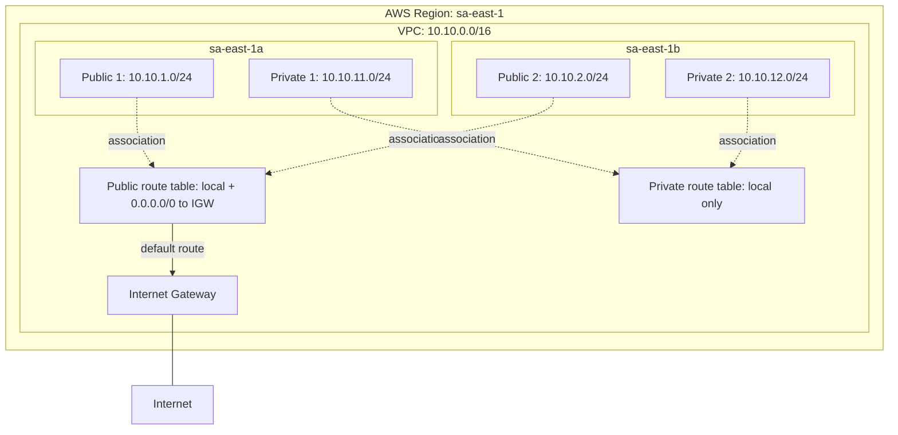

# LAB 01 — Amazon VPC & Networking Fundamentals

[Repository home](../../README.md) · [Contributing](../../CONTRIBUTING.md) · [Engineering review](../../docs/lab01-engineering-review.md)

## 1. Overview

Build a two-Availability-Zone IPv4 network in `sa-east-1` using Terraform. This lab introduces subnet classification, explicit route table associations, DNS settings, account safeguards and infrastructure validation.

The repository owner confirmed that the original infrastructure was provisioned, inspected using AWS CLI and Terraform State, and successfully destroyed. No workload connectivity tests were performed. This engineering review does not provision infrastructure or repeat the historical AWS validation.

## 2. Business Scenario

A team needs a network foundation for future public entry points and private application components. Before deploying workloads, it must make addressing, routing, ownership and lifecycle decisions explicit and reproducible.

This is a networking foundation, not a production application or a complete high-availability system. Two AZs provide placement options; no compute, failover or application availability was tested.

## 3. Architecture

| Terraform-managed component | Quantity |
| --- | ---: |
| VPC | 1 |
| Public subnets | 2 |
| Private subnets | 2 |
| Internet Gateway | 1 |
| Custom route tables | 2 |
| Explicit subnet route table associations | 4 |
| **Total managed resources** | **12** |

The public default route is an inline block in its route table, not an additional Terraform resource. AWS also creates default VPC objects, including a main route table, security group and network ACL; these are not separately managed by this configuration or counted above.

Both subnet tiers have one subnet in each AZ. VPC DNS support and DNS hostnames are enabled. Public subnets enable automatic public IPv4 assignment for future launches; private subnets disable it. No EC2, NAT Gateway, Elastic IP, Load Balancer or VPC endpoint is included.

## 4. Architecture Diagram



Dashed edges show configuration associations. The diagram does not represent observed traffic or tested connectivity. The private route table has no internet default route.

## 5. Network Addressing

| Scope | IPv4 CIDR | AZ | Public IPv4 on launch |
| --- | --- | --- | --- |
| VPC | `10.10.0.0/16` | Regional | N/A |
| Public 1 | `10.10.1.0/24` | `sa-east-1a` | Enabled |
| Public 2 | `10.10.2.0/24` | `sa-east-1b` | Enabled |
| Private 1 | `10.10.11.0/24` | `sa-east-1a` | Disabled |
| Private 2 | `10.10.12.0/24` | `sa-east-1b` | Disabled |

Keep these defaults to reproduce the validated architecture. AZ names can map to different physical zones across AWS accounts; confirm availability in your account before deployment. Variable validation checks syntax, two-entry list alignment and uniqueness within each list. It does not prove CIDR containment, non-overlap across tiers or AWS-side AZ availability; review these before changing inputs.

## 6. Routing Configuration

| Custom route table | Destination | Target | Associated subnets |
| --- | --- | --- | --- |
| Public | `10.10.0.0/16` | `local` (AWS-created route) | Public 1 and 2 |
| Public | `0.0.0.0/0` | Internet Gateway | Public 1 and 2 |
| Private | `10.10.0.0/16` | `local` (AWS-created route) | Private 1 and 2 |

The private tier is isolated from direct internet routing. A public subnet's route alone does not establish workload reachability: a future instance also requires a public address and appropriate security group and network ACL rules. The local route supplies VPC routing, not an authorization guarantee. See [AWS route table documentation](https://docs.aws.amazon.com/vpc/latest/userguide/VPC_Route_Tables.html).

## 7. Architecture Decisions

- Keep a single Terraform root and direct resource references. Twelve resources do not justify a module hierarchy or external modules.
- Preserve `count` and ordered subnet lists to retain existing resource addresses. Reordering AZs or CIDRs can replace indexed subnets and their associations. A future switch to `for_each` requires reviewed `moved` blocks or state migration.
- Retain the original Name and Tier tags, plus provider defaults: `Project=aws-saa-labs`, `Lab=lab01`, `Environment=lab`, `ManagedBy=Terraform`.
- Retain two shared custom route tables: one per routing policy. A private table per AZ offers no benefit while each contains only the local route.
- Omit NAT and workloads to keep scope and cost focused on network configuration.
- Require `aws_account_id` locally and enforce `allowed_account_ids`. This replaces the original account-specific constant without weakening the guard. Existing users must supply their account ID before planning; it is an input change, not a resource address change.
- Keep local state for this individual lab. A shared encrypted backend needs separate design and authorization; none is created here.

## 8. Technologies

Terraform CLI `1.15.8` is the CI baseline; the configuration accepts `>= 1.15.0, < 2.0.0`. The AWS provider constraint is `~> 6.0`, resolved to `6.74.0` in the committed lock file. GitHub Actions runs on `ubuntu-24.04`; Python 3 discovers roots using only the standard library. AWS CLI v2 supports human-operated validation; Mermaid documents the architecture.

## 9. Repository Structure

```text
labs/lab01-vpc-networking/
├── README.md
└── terraform/
    ├── .gitignore
    ├── .terraform.lock.hcl
    ├── main.tf
    ├── outputs.tf
    ├── providers.tf
    ├── terraform.tfvars.example
    ├── variables.tf
    └── versions.tf
```

The [CI workflow](../../.github/workflows/terraform-ci.yml) and [discovery script](../../shared/scripts/discover-terraform.py) are shared. Local policies or evidence outside this tracked structure are not validated deliverables.

## 10. Prerequisites

- Your own AWS account, preferably a dedicated member/sandbox account, and authorization to create and remove the listed networking resources.
- Terraform `1.15.8`, AWS CLI v2, Git, and network access to the provider registry and HashiCorp downloads.
- Temporary federated credentials, preferably IAM Identity Center with MFA. Choose your own AWS CLI profile; do not use static access keys.
- A separately reviewed permission set covering the Terraform lifecycle and read operations. The [LAB 00](../lab00-identity-governance/README.md) read-only operator policy is insufficient. No complete LAB 01 IAM policy is published or certified by this review.
- Review of account, Region, costs, dependencies and local state storage before execution.

LAB 00 is the identity/governance reference; this Terraform root does not consume its state or create/alter its IAM or Organizations configuration. Existing equivalent federation can be used in another account. LAB 01 owns all 12 network resources; no provisioned network resources are inherited.

## 11. Deployment Instructions

These commands are procedures for an authorized human operator. They were not executed against AWS during this engineering review. `apply` requires separate explicit authorization; CI never executes it.

From the repository root:

```bash
cd labs/lab01-vpc-networking/terraform
umask 077
cp terraform.tfvars.example terraform.tfvars
```

Edit the ignored `terraform.tfvars`: replace the all-zero placeholder with your own authorized 12-digit account ID and set `aws_profile` to your authenticated profile. Keep all network defaults. The placeholder intentionally cannot authorize a real account. To use the standard temporary credential chain, set `aws_profile = null`.

For the profile-based path, use the same profile for the CLI checks and Terraform:

```bash
export AWS_PROFILE=your-sso-profile
export AWS_REGION=sa-east-1
aws sso login --profile "$AWS_PROFILE"
aws sts get-caller-identity --query Account --output text
terraform fmt -check -recursive
terraform init -backend=false -input=false -lockfile=readonly
terraform validate
terraform plan -out=lab01.tfplan
```

Match the account returned by STS to the local authorized account ID, and ensure `aws_profile` matches `AWS_PROFILE`. Inspect the plan: a fresh state should propose **12 additions**, with the addressing and routes above. Stop if targets or changes differ. Existing state may yield no changes. Never publish the plan, state or raw CLI output.

Only after explicit approval of that saved plan:

```bash
terraform apply lab01.tfplan
```

Retain private state until cleanup is complete. Never discard state to start over; investigate any unexpected existing resources first.

## 12. Infrastructure Validation

After an authorized deployment, run from the Terraform directory with the same temporary credentials, account and Region:

```bash
terraform state list
terraform output
VPC_ID=$(terraform output -raw vpc_id)
aws ec2 describe-vpcs --vpc-ids "$VPC_ID" --region "$AWS_REGION"
aws ec2 describe-vpc-attribute --vpc-id "$VPC_ID" --attribute enableDnsSupport --region "$AWS_REGION"
aws ec2 describe-vpc-attribute --vpc-id "$VPC_ID" --attribute enableDnsHostnames --region "$AWS_REGION"
aws ec2 describe-subnets --filters "Name=vpc-id,Values=$VPC_ID" --region "$AWS_REGION"
aws ec2 describe-internet-gateways --filters "Name=attachment.vpc-id,Values=$VPC_ID" --region "$AWS_REGION"
aws ec2 describe-route-tables --route-table-ids "$(terraform output -raw public_route_table_id)" "$(terraform output -raw private_route_table_id)" --region "$AWS_REGION"
```

Expected evidence: 12 managed state entries; four subnets with the exact CIDRs, AZs and public-IP settings; both DNS attributes enabled; one attached IGW; one public IGW default route; one private local-only table; four explicit subnet associations; and consistent tags. Inspect both route tables' association lists. Outputs expose the VPC, subnet, gateway and custom route table IDs for local inspection.

These checks inspect configuration and Terraform ownership. They do not test traffic, failover, throughput, workload security or effective IAM permissions. Do not add workloads merely to claim connectivity validation in this lab.

## 13. CI/CD Workflow

This repository implements CI only. The matrix discovers tracked roots matching `labs/labNN-topic/terraform/` with direct `.tf` files; every root must track `versions.tf` and `.terraform.lock.hcl`. Missing required files fail discovery; an empty matrix is logged and skipped. Provider caches and untracked directories cannot enter the matrix.

Pushes to `main`, `feat/**`, `fix/**`, `chore/**`, pull requests targeting `main`, and manual dispatch trigger checks when applicable paths change. Each root runs `fmt -check -recursive`, backend-free readonly-lock `init` and `validate` independently. Validation failures do not cancel other matrix roots. Four jobs may validate concurrently; discovery rejects more than GitHub's 256 matrix entries.

The workflow uses read-only repository permissions, SHA-pinned actions with Node.js 24 runtimes, no persisted checkout credentials, job timeouts and cancellation of older runs on the same ref. Terraform and the provider lock remain at their validated versions. Runner images and network downloads still evolve; SHA pins do not make the entire environment immutable. There are no AWS credentials, OIDC, remote backend access, plans, deploys or cleanup jobs. See the [review report](../../docs/lab01-engineering-review.md) for actual execution evidence.

## 14. Security and Governance

The account allowlist reduces wrong-account deployment risk; it does not grant permissions or replace IAM review. Profile selection is portable and uses temporary credentials. Do not expand LAB 00's policy or modify IAM/Organizations as part of this lab.

Local state and saved plans can contain sensitive values and resource identifiers. They are ignored by Git, but must also be access-restricted on disk, kept out of shared logs/backups and inspected before staging. Commit the provider lock file and sanitized examples only. Do not publish session ARNs or real account/resource IDs as evidence.

The configuration leaves AWS-created default security group and network ACL behavior unchanged. It is not network hardening for future workloads. Review workload-specific controls, logging and state collaboration separately before extending it.

## 15. Cost Considerations

The configuration includes no compute, NAT Gateway, allocated public IPv4 addresses, load balancers or endpoints. Enabling subnet public-IP assignment does not allocate an address by itself. The listed basic VPC components do not introduce hourly service charges under the current pricing model; future public IPv4 usage, data transfer and added services can incur charges. Recheck [official VPC pricing](https://aws.amazon.com/vpc/pricing/) before deployment.

This scope is not evidence that an entire account is free of charges. Use existing billing visibility and review dependencies before cleanup. No paid monitoring or billing resources are introduced here.

## 16. SAA-C03 Key Concepts

- Design secure network foundations: VPC boundaries, subnet tiers and separation of routing from security controls.
- Design resilient architectures: regional VPC versus AZ-scoped subnets; two AZs do not by themselves guarantee application availability.
- Design appropriate networking: local routes, longest-prefix routing, explicit associations and IGW requirements for public IPv4 traffic.
- Design cost-optimized architectures: understand when NAT, public IPv4 and endpoints are necessary before adding their costs.
- Apply governance and repeatability: temporary credentials, account safeguards, tags, version locks and reviewed IaC changes.

## 17. Cleanup Instructions

The original deployment has already been destroyed. Do not run cleanup against another account or unrelated resources. After any future deployment, the operator who owns the state is responsible for removal or documented retention.

Before cleanup, confirm the account, Region, exact state and downstream consumers. No later lab is currently documented as a consumer. If future labs reuse this network, record them and remove their dependencies first; do not destroy shared foundations still in use. Reuse is an option, not evidence that resources currently exist.

For an explicitly authorized cleanup, from the same root and state:

```bash
aws sts get-caller-identity --query Account --output text
terraform plan -destroy -out=lab01-cleanup.tfplan
```

Review the destruction plan and obtain approval for its targets and dependencies before executing:

```bash
terraform apply lab01-cleanup.tfplan
terraform state list
aws ec2 describe-vpcs --filters Name=tag:Project,Values=aws-saa-labs Name=tag:Lab,Values=lab01 --region "$AWS_REGION"
```

An empty state plus absence of the targeted VPC supports cleanup verification for this lab, not account-wide billing clearance. Remove ignored local plan files after use according to your retention requirements; retain protected recovery evidence as needed. Never delete state before resources are removed. Do not remove LAB 00 identity/governance foundations.

## 18. Results

The owner confirmed successful provisioning and destruction of the original 12-resource architecture, with AWS CLI and Terraform State validation. No EC2 or other workload was deployed and no connectivity test was run. Public raw deployment evidence is intentionally omitted to avoid exposing identifiers.

This review preserves all resource blocks, addresses, network defaults and tags. It adds portable account restriction, input validation, complete output descriptions, CI hardening and reproducible documentation. This is a configuration review; the revised code has not been redeployed. Actual local/remote checks and their limitations are recorded in the [engineering report](../../docs/lab01-engineering-review.md).

## 19. Official References

- [Amazon VPC user guide](https://docs.aws.amazon.com/vpc/latest/userguide/what-is-amazon-vpc.html)
- [Subnet route tables](https://docs.aws.amazon.com/vpc/latest/userguide/VPC_Route_Tables.html)
- [Internet Gateway](https://docs.aws.amazon.com/vpc/latest/userguide/VPC_Internet_Gateway.html)
- [Amazon VPC pricing](https://aws.amazon.com/vpc/pricing/)
- [AWS CLI IAM Identity Center authentication](https://docs.aws.amazon.com/cli/latest/userguide/cli-configure-sso.html)
- [Terraform AWS provider configuration](https://registry.terraform.io/providers/hashicorp/aws/latest/docs)
- [Terraform dependency lock file](https://developer.hashicorp.com/terraform/language/files/dependency-lock)
- [GitHub Actions secure use](https://docs.github.com/en/actions/reference/security/secure-use)
- [AWS Certified Solutions Architect — Associate](https://aws.amazon.com/certification/certified-solutions-architect-associate/)
