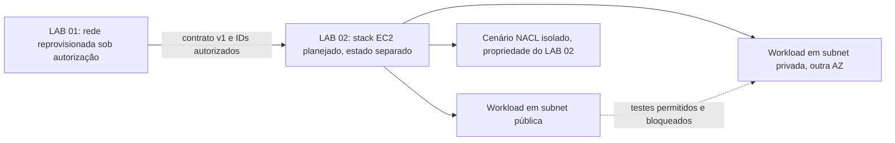

# LAB 02 — Amazon EC2 & Network Connectivity

**Status: planejado.** Este documento define o cenário e os critérios para implementação futura. Não há Terraform, EC2 provisionada ou resultado de teste neste LAB. [Manifesto](lab.yaml) · [Roadmap](../../docs/roadmap/README.md).

## Cenário corporativo e aprendizagem

Uma equipe precisa comprovar a conectividade real da fundação de rede antes de hospedar uma aplicação. O [LAB 01](../lab01-vpc-networking/README.md) validou configurações no Control Plane e destruiu seus 12 recursos; não testou Data Plane. Este será o primeiro consumidor planejado de `network-foundation`.

Objetivos L2–L3: interpretar o caminho de pacotes, comprovar comunicação entre AZs, distinguir rotas de autorização, comparar IPv4 público/privado, diagnosticar Security Groups e Network ACLs e demonstrar bloqueios intencionais. Planejar etapas de 45–75 minutos para acesso seguro, conectividade e diagnóstico/cleanup, sem reduzir os testes para caber em uma sessão única.

## Arquitetura proposta e requisitos

Reprovisionar o LAB 01 somente após autorização, manter sua rede temporariamente e criar um stack consumidor separado para EC2, Security Groups, interfaces e volumes pertencentes ao LAB 02. Distribuir instâncias de teste entre subnets públicas/privadas e AZs conforme a matriz mínima aprovada; quantidade, AMI, tamanho e custo serão definidos antes da implementação, não são recursos existentes.

Consumir os seis outputs existentes por inputs propostos em [network-foundation v1](../../docs/architecture/dependencies.md). Usar Terraform States separados e transferência local por allowlist; nunca gerenciar VPC, subnets, IGW, Route Tables ou associações do LAB 01 no estado do LAB 02. Conferir conta, região `sa-east-1`, tags, AZs, IDs, versão do contrato e ausência de consumidores incompatíveis antes de executar.

## Acesso administrativo e alternativas

Preferir acesso temporário e origem restrita. Proposta inicial: SSH com chave efêmera local protegida e ProxyJump por instância pública controlada, sem expor SSH das instâncias privadas e sem `0.0.0.0/0` em acesso administrativo. O host público usado como salto exige endurecimento e autorização explícita; nunca copiar chave privada para ele. Avaliar revogação, origem autorizada e evidência sanitizada antes de implementar.

SSM Session Manager é alternativa apenas se os pré-requisitos de IAM, agente e conectividade forem satisfeitos. A subnet privada atual não tem egress de internet, NAT ou endpoints: **não presumir que SSM funcionará**. Adicionar NAT/endpoints ou mudar IAM exige revisão própria de custo/arquitetura; não integra esta fundação. Evitar depender de instalação de pacotes pela internet em instâncias privadas; escolher ferramentas já presentes na imagem aprovada.

## Plano de testes, sem execução nesta fase

| Hipótese | Teste positivo planejado | Teste negativo planejado | Evidência esperada |
| --- | --- | --- | --- |
| Comunicação privada entre AZs | Porta de teste específica permitida entre SGs | Porta sem autorização bloqueada | Origem/destino lógico, protocolo, horário, sucesso/timeout e correlação com regras |
| Acesso externo da subnet pública | IPv4 público + IGW + controles permitirem requisição | Origem administrativa fora da allowlist bloqueada | Caminho e regra responsáveis, sem expor IP/IDs em publicação |
| Isolamento privado da internet | Comunicação interna permitida | Saída direta IPv4 para internet falha sem rota/NAT | Inspeção do Control Plane e resultado do Data Plane separados |
| Comportamento stateful de SG | Resposta do fluxo permitido | Novo fluxo não autorizado bloqueado | Regras e teste de sessão distintos |
| Comportamento stateless de NACL | Regra de ida/retorno e portas efêmeras adequadas | Regra de retorno ausente ou deny específico bloqueia | Diagnóstico no cenário isolado, sem editar NACL padrão do LAB 01 |

Roteamento e NACLs nas quatro subnets herdadas serão **somente inspecionados**. Para testar mudanças negativas de rotas/NACL, propor fixture descartável em subnet adicional pertencente ao LAB 02, dentro de faixa livre da VPC previamente revisada, com sua própria Route Table, NACL e associações. Não alterar associações, rotas ou NACL padrão usados pelo LAB 01. Esse incremento exige aprovação na implementação; não atribuir seu ownership ao LAB 01. Se não houver aprovação/orçamento, limitar esses testes a inspeção/simulação e declarar a lacuna de Data Plane correspondente.

Não presumir que timeout identifica sozinho o controle responsável. Troubleshooting deve conferir DNS quando usado, endereços, AZ, rotas, associação da subnet, SG de origem/destino, NACL nos dois sentidos, portas efêmeras, serviço em escuta e firewall do sistema operacional. Registrar hipóteses e alterar uma variável controlada por vez; reverter somente recursos pertencentes ao consumidor.

## Custos, confiabilidade e cleanup integrado

Avaliar EC2, EBS, IPv4 público e transferência entre AZs na região/data de execução; Free Tier não assegura gratuidade. Nenhuma quantidade/preço é prometida aqui. Evitar NAT, endpoints ou logs pagos sem justificativa. Se não houver orçamento, usar desenho/simulação e registrar o que não foi comprovado.

O operador mantém inventário privado, responsável, prazo de retenção e consumidores ativos conforme [FinOps](../../docs/standards/finops-security.md). Remover primeiro EC2, volumes/interfaces e fixture do LAB 02, verificar remanescentes e ausência de consumidores e só então remover a rede LAB 01 com aprovação. Não deixar SGs/ENIs impedindo cleanup; não apagar estados para contornar dependências. Falhas intermediárias exigem reconciliação, preservando a fundação ainda em uso.

## Questões autorais e critérios de aceite futuro

1. Por que uma rota ao IGW não torna uma instância privada acessível? Justificar requisitos de endereço e autorização.
2. Por que uma resposta pode ser permitida no SG e bloqueada na NACL? Explicar estado de conexão e portas de retorno.
3. Por que dois states não podem gerenciar a mesma Route Table? Explicar ownership e risco de destruição.

Aceite futuro: contrato verificado, estados isolados, acesso administrativo restrito, testes positivos/negativos reproduzíveis no escopo aprovado, hipóteses de troubleshooting justificadas, evidências reais sanitizadas, custos revisados e cleanup integrado ou retenção formal. Não há aceite de execução nesta entrega. Aplicar [Quality Gates](../../docs/standards/quality-gates.md), três entregáveis de publicação e retrospectiva, registrando lacunas sem inventar resultados.

Referências: [Internet Gateway](https://docs.aws.amazon.com/vpc/latest/userguide/VPC_Internet_Gateway.html), [Security Groups](https://docs.aws.amazon.com/vpc/latest/userguide/vpc-security-groups.html), [Network ACLs](https://docs.aws.amazon.com/vpc/latest/userguide/vpc-network-acls.html) e [preços EC2](https://aws.amazon.com/ec2/pricing/).
